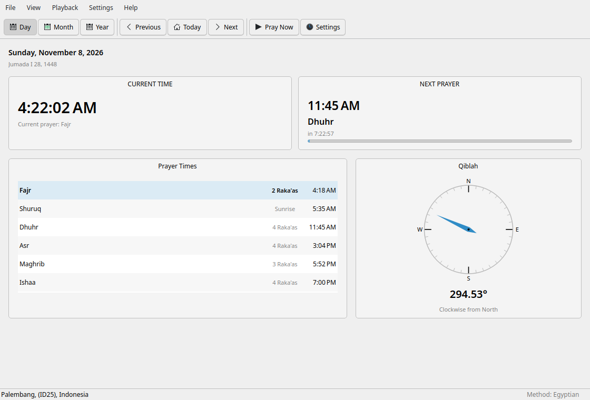
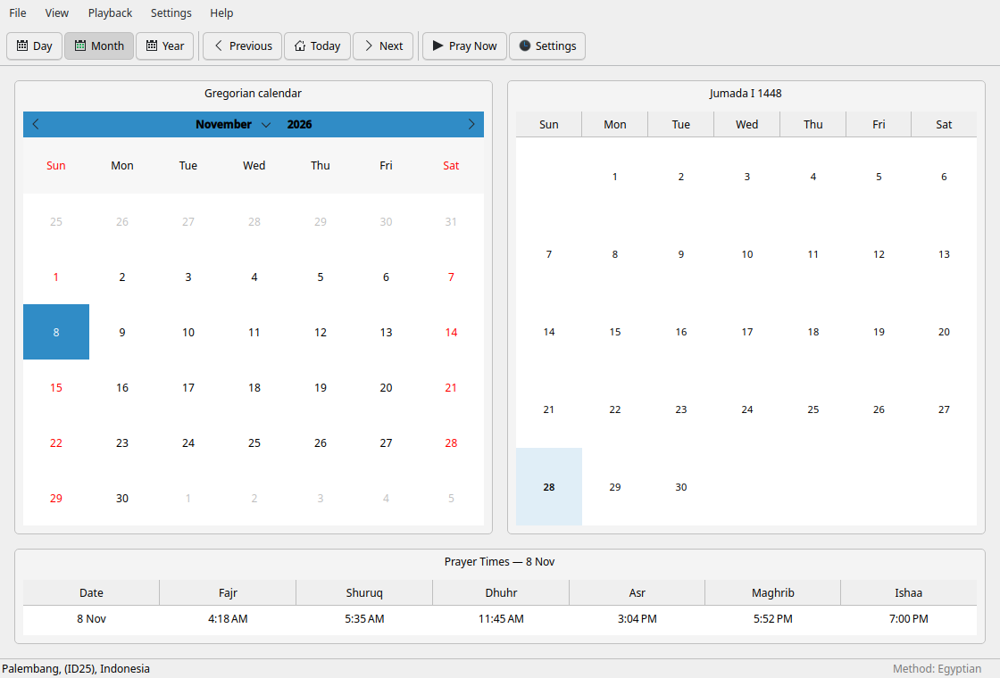
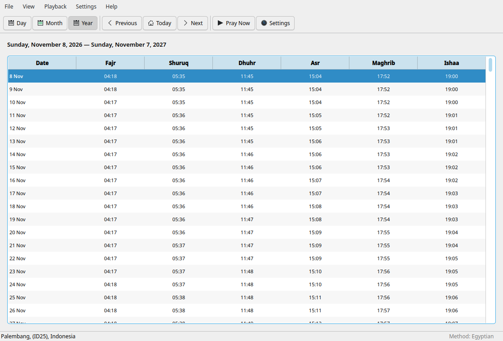
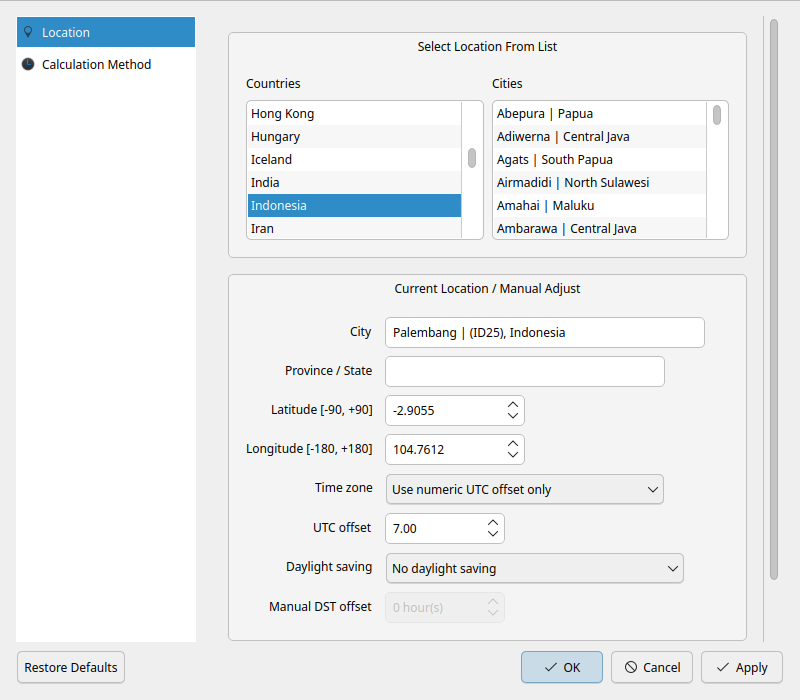
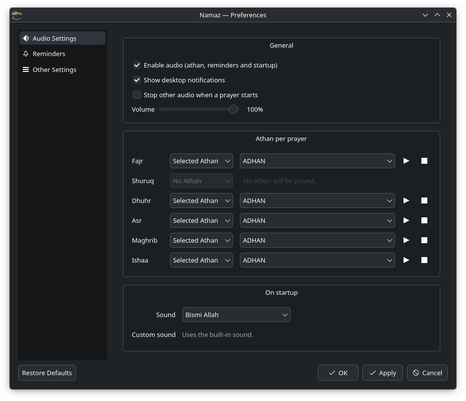

<p align="center">
  
</p>

<h1 align="center">Namaz</h1>

<p align="center">
  Muslim prayer times, Qibla direction and Hijri calendar for Linux.<br>
  Native Rust prayer engine + Qt 6 Widgets.
</p>

<p align="center">
  <a href="LICENSE"></a>
  <a href="https://www.rust-lang.org/"></a>
  <a href="https://www.qt.io/"></a>
  <a href="https://flatpak.org/"></a>
  <a href="https://github.com/ikhlasulov-gb/namaz/releases"></a>
</p>

<p align="center">
  <a href="README.md">English</a> · <a href="README.ru.md">Русский</a>
</p>

## Overview

**Namaz** is a free, native Linux application for the five daily prayers. It
calculates prayer times from your coordinates and chosen calculation method,
shows the Qibla direction and a Hijri calendar, and can play the adhan,
reminders and iqama from the system tray.

The interface follows the KDE Plasma human interface guidelines and integrates
with the desktop through XDG autostart, a D-Bus API, desktop notifications and
the KDE screen locker.  The prayer engine is written in Rust; the frontend is
Qt 6 Widgets.

<p align="center">
  
</p>

## Features

- **Day, Month and Year views** with Gregorian and Hijri calendars.
- **Accurate prayer engine** ported from the Islamic Times Library (ITL).
- **Calculation methods**: Custom, Egyptian, ISNA, MWL, Umm al-Qura, Karachi
  and more, with Standard/Hanafi Asr and high-latitude rules.
- **Qibla compass** with true bearing and cardinal direction.
- **Adhan, reminders and iqama**: built-in audio, per-prayer modes, custom
  files and folders.
- **Desktop integration**: tray icon, notifications, D-Bus API, autostart,
  screen-locker support and a Masjid full-screen view.
- **Export**: PDF and CSV (Gregorian, Hijri and Outlook CSV).
- **Localisation**: English and Russian.
- **Privacy**: no telemetry, no account, no network access required for
  prayer-time calculations.

<p align="center">
  
  
</p>

<p align="center">
  
  
</p>

## Installation

### Flatpak (recommended)

The signed Flatpak repository is hosted on GitHub Pages and updates through
`flatpak update` / your software centre.

```bash
flatpak remote-add --if-not-exists --user namaz \
  https://ikhlasulov-gb.github.io/namaz/namaz.flatpakrepo
flatpak install --user namaz io.github.ikhlasulov_gb.Namaz
flatpak run io.github.ikhlasulov_gb.Namaz
```

### AppImage

Download the latest AppImage for your architecture from
[Releases](https://github.com/ikhlasulov-gb/namaz/releases), then:

```bash
chmod +x Namaz-1.0.0-x86_64.AppImage
./Namaz-1.0.0-x86_64.AppImage
```

### Portable archive

```bash
tar -xzf namaz-1.0.0-linux-x86_64.tar.gz
./namaz/run.sh
```

The portable archive needs a system Qt 6 runtime.  Flatpak is the recommended
way to get a self-contained build on any distribution.

## Updating

- **Flatpak**: `flatpak update --user io.github.ikhlasulov_gb.Namaz`
  (or use GNOME Software / KDE Discover).
- **In the application**: `Help → Check for Updates…` checks the latest GitHub
  release, shows the release notes and offers the download link.  AppImage
  builds can download and replace themselves after verifying SHA-256.
- **Portable**: download the new archive and replace the old directory.

## Building from source

Requirements: Rust 1.92+, CMake 3.21+, Ninja, Qt 6.5+ (Widgets, DBus,
Network, PrintSupport, LinguistTools) and ALSA development headers.

```bash
git clone https://github.com/ikhlasulov-gb/namaz.git
cd namaz
cmake -S ui -B ui/build -DCMAKE_BUILD_TYPE=Release
cmake --build ui/build -j"$(nproc)"
./ui/build/namaz
```

Common packages:

```bash
# Fedora / AlmaLinux
sudo dnf install cmake ninja-build qt6-qtbase-devel qt6-qttools-devel alsa-lib-devel

# Ubuntu / Debian
sudo apt install cmake ninja-build qt6-base-dev qt6-tools-dev \
  qt6-tools-dev-tools qt6-translations-l10n libasound2-dev

# Arch
sudo pacman -S cmake ninja qt6-base qt6-tools alsa-lib
```

Tests:

```bash
cargo test -p prayer-core -p namaz-core
QT_QPA_PLATFORM=offscreen ctest --test-dir ui/build --output-on-failure
./scripts/diff-itl.sh 1500
```

Flatpak:

```bash
flatpak install -y flathub org.flatpak.Builder org.kde.Sdk//6.10 \
  org.freedesktop.Sdk.Extension.rust-stable//25.08
flatpak run org.flatpak.Builder --user --install --force-clean \
  --repo=repo build packaging/io.github.ikhlasulov_gb.Namaz.yml
```

## Project structure

```text
crates/prayer-core   ITL port + golden and differential tests
crates/core          config, calendars, Hijri, Qibla, audio, C ABI
ui/                  Qt 6 Widgets frontend, dialogs, tray, D-Bus
ui/tests/            Qt Test suite
assets/              audio, GeoNames city database, icons
packaging/           Flatpak, desktop entry, AppStream metadata
scripts/             build, release, smoke tests
third_party/itl/     original LGPL ITL C sources (test reference)
```

## Credits

Namaz was inspired by **Salaat Time 3.0**.  We thank its authors for their
work.  We decided to write a free implementation because the original is
closed-source and had critical bugs in prayer-time calculation and daily use.
May Allah reward them for their intentions and efforts.

> Namaz is an independent project.  It is not affiliated with, endorsed by, or
> supported by the authors of Salaat Time.

The public build contains only free assets:

- **Prayer engine**: port of the [Islamic Times Library](third_party/itl)
  by Arabeyes / Thamer Mahmoud (LGPL-2.1-or-later).
- **City database**: [GeoNames](https://www.geonames.org/) `cities5000`
  (CC BY 4.0).
- **Audio**: Quran recitation (Bismillah, Al-Ikhlas) by Mishary Rashid
  Alafasy, adhan by Ahmad bin Abdul-Aziz Al-Nufais (no licence stated).
- **Icons**: original artwork by Ikhlasulov.
- **Desktop**: Qt 6 and the KDE Plasma guidelines.

No Salaat Time code, executables, audio, city data, icons or screenshots are
distributed in this repository.

## License

Copyright (C) 2026 Ikhlasulov.

Namaz is free software: you can redistribute it and/or modify it under the
terms of the **GNU General Public License, version 3 or later**.  See
[LICENSE](LICENSE) for the full text.  Third-party components are described in
[THIRD_PARTY.md](THIRD_PARTY.md).

## Author

**Ikhlasulov** — [github.com/ikhlasulov-gb](https://github.com/ikhlasulov-gb)

Contributions, bug reports and translations are welcome.
