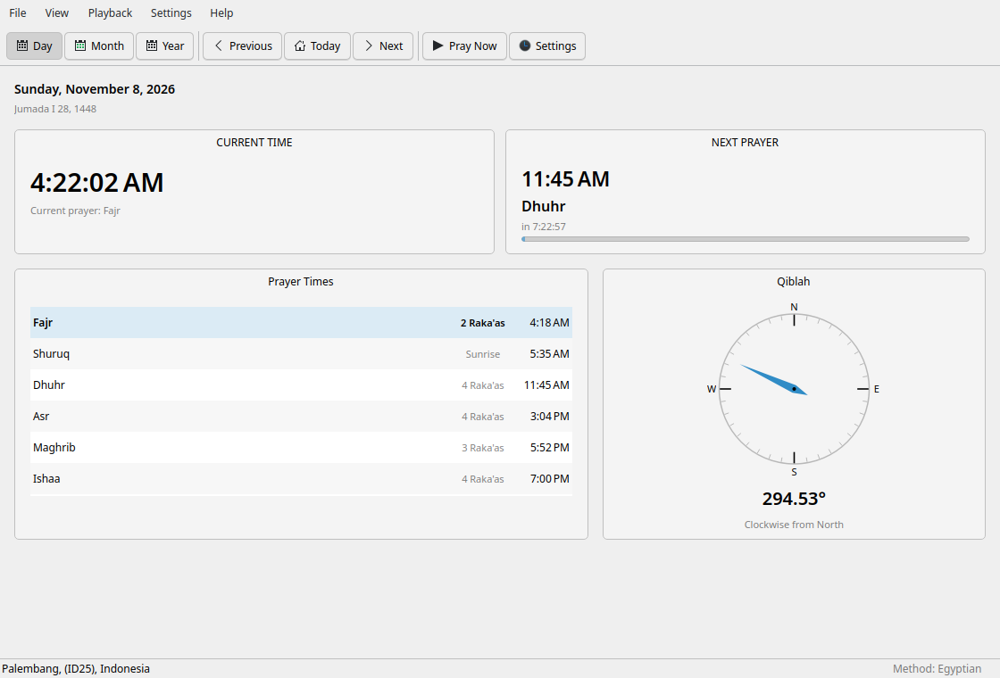
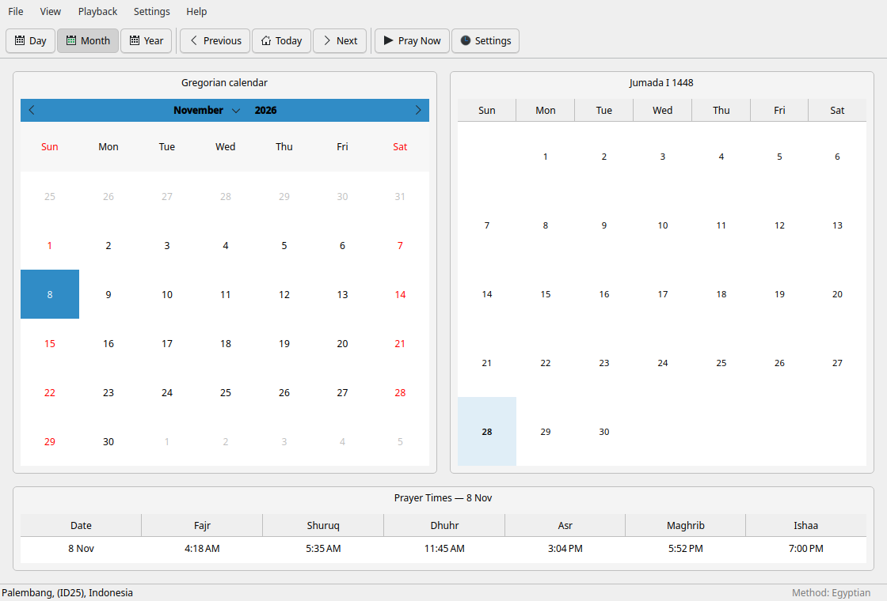
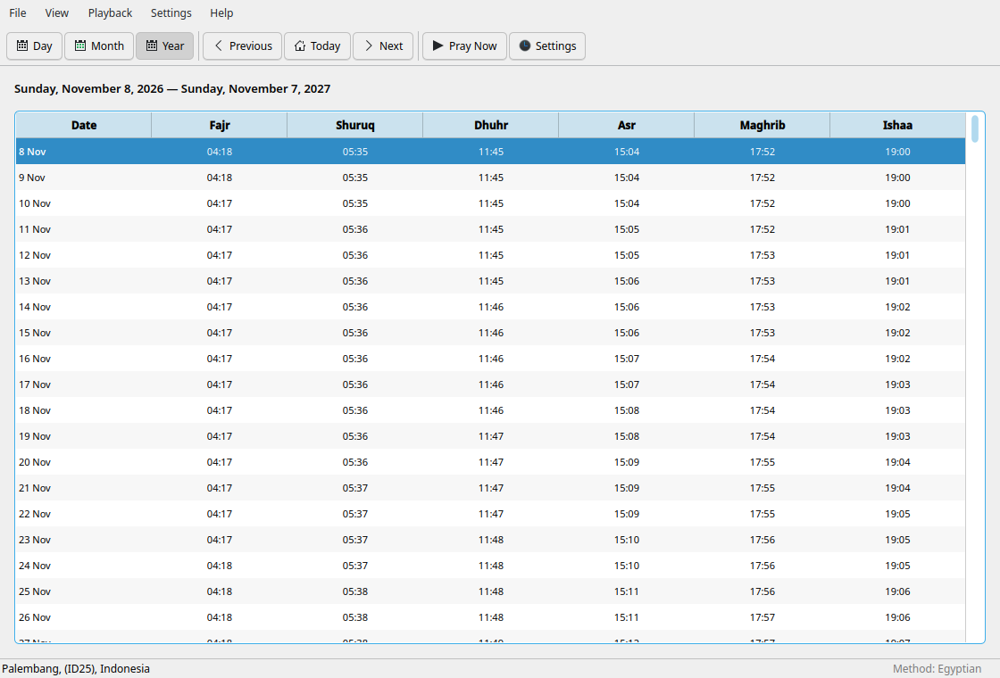
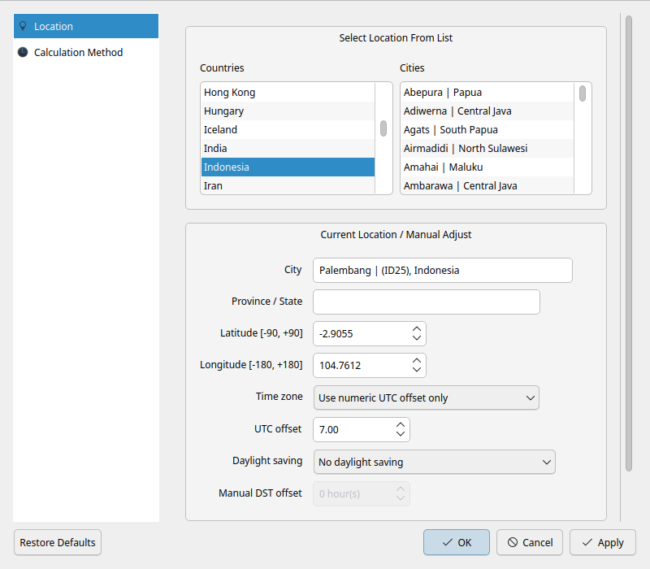
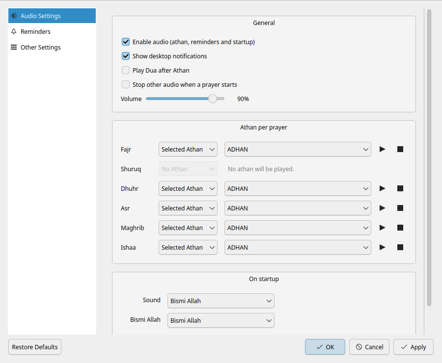

<p align="center">
  
</p>

<h1 align="center">Namaz</h1>

<p align="center">
  Время мусульманских молитв, направление Киблы и хиджрийский календарь для Linux.<br>
  Нативное ядро на Rust + интерфейс Qt 6 Widgets.
</p>

<p align="center">
  <a href="LICENSE"></a>
  <a href="https://www.rust-lang.org/"></a>
  <a href="https://www.qt.io/"></a>
  <a href="https://flatpak.org/"></a>
</p>

<p align="center">
  <a href="README.md">English</a> · <a href="README.ru.md">Русский</a>
</p>

## Обзор

**Namaz** — свободное нативное приложение для Linux для пяти ежедневных
молитв. Оно рассчитывает время намаза по координатам и выбранному методу,
показывает направление Киблы и хиджрийский календарь, умеет проигрывать
азан, напоминания и икаму из системного трея.

Интерфейс следует рекомендациям KDE Plasma HIG и интегрируется с рабочим
столом через XDG autostart, D-Bus API, уведомления и блокировщик экрана KDE.
Движок расчёта написан на Rust, интерфейс — на Qt 6 Widgets.

<p align="center">
  
</p>

## Возможности

- **Экраны Day, Month и Year** с григорианским и хиджрийским календарями.
- **Точный движок расчёта**, портированный из Islamic Times Library (ITL).
- **Методы расчёта**: Custom, Egyptian, ISNA, MWL, Umm al-Qura, Karachi и
  другие, мазхаб Standard/Hanafi и правила для высоких широт.
- **Компас Киблы** с истинным азимутом и сторонами света.
- **Азан, напоминания и икама**: встроенное аудио, режимы для каждой
  молитвы, свои файлы и папки.
- **Интеграция с рабочим столом**: трей, уведомления, D-Bus API, автозапуск,
  блокировка экрана и полноэкранный экран Masjid.
- **Экспорт**: PDF и CSV (григорианский, хиджрийский и Outlook CSV).
- **Локализация**: английский и русский.
- **Приватность**: без телеметрии, аккаунтов и сетевых запросов для расчёта.

<p align="center">
  
  
</p>

<p align="center">
  
  
</p>

## Установка

### Flatpak (рекомендуется)

Подписанный Flatpak-репозиторий размещён на GitHub Pages и обновляется через
`flatpak update` или центр приложений.

```bash
flatpak remote-add --if-not-exists --user namaz \
  https://ikhlasulov-gb.github.io/namaz/namaz.flatpakrepo
flatpak install --user namaz io.github.ikhlasulov_gb.Namaz
flatpak run io.github.ikhlasulov_gb.Namaz
```

### AppImage

Скачайте AppImage для своей архитектуры из
[Releases](https://github.com/ikhlasulov-gb/namaz/releases):

```bash
chmod +x Namaz-1.0.0-x86_64.AppImage
./Namaz-1.0.0-x86_64.AppImage
```

### Портативный архив

```bash
tar -xzf namaz-1.0.0-linux-x86_64.tar.gz
./namaz/run.sh
```

Портативной версии нужен системный Qt 6. Flatpak — рекомендуемый способ
получить самодостаточную сборку на любом дистрибутиве.

## Обновление

- **Flatpak**: `flatpak update --user io.github.ikhlasulov_gb.Namaz`
  (или GNOME Software / KDE Discover).
- **В приложении**: `Help → Check for Updates…` проверяет последний релиз на
  GitHub, показывает список изменений и ссылку на скачивание. AppImage умеет
  скачать и заменить себя после проверки SHA-256.
- **Портативная версия**: скачайте новый архив и замените старую папку.

## Сборка из исходников

Нужны Rust 1.92+, CMake 3.21+, Ninja, Qt 6.5+ (Widgets, DBus, Network,
PrintSupport, LinguistTools) и заголовки ALSA.

```bash
git clone https://github.com/ikhlasulov-gb/namaz.git
cd namaz
cmake -S ui -B ui/build -DCMAKE_BUILD_TYPE=Release
cmake --build ui/build -j"$(nproc)"
./ui/build/namaz
```

Пакеты:

```bash
# Fedora / AlmaLinux
sudo dnf install cmake ninja-build qt6-qtbase-devel qt6-qttools-devel alsa-lib-devel

# Ubuntu / Debian
sudo apt install cmake ninja-build qt6-base-dev qt6-tools-dev \
  qt6-tools-dev-tools qt6-translations-l10n libasound2-dev

# Arch
sudo pacman -S cmake ninja qt6-base qt6-tools alsa-lib
```

Тесты:

```bash
cargo test -p prayer-core -p namaz-core
QT_QPA_PLATFORM=offscreen ctest --test-dir ui/build --output-on-failure
./scripts/diff-itl.sh 1500
```

Flatpak:

```bash
flatpak install -y flathub org.flatpak.Builder org.kde.Sdk//6.10 \
  org.freedesktop.Sdk.Extension.rust-stable//25.08
flatpak run org.flatpak.Builder --user --install --force-clean \
  --repo=repo build packaging/io.github.ikhlasulov_gb.Namaz.yml
```

## Структура проекта

```text
crates/prayer-core   порт ITL + golden- и differential-тесты
crates/core          конфиг, календари, хиджра, Кибла, аудио, C ABI
ui/                  интерфейс Qt 6 Widgets, диалоги, трей, D-Bus
ui/tests/            тесты Qt Test
assets/              аудио CC0, база GeoNames, иконки
packaging/           Flatpak, desktop, AppStream
scripts/             сборка, релизы, smoke-тесты
third_party/itl/     исходники ITL (LGPL) для differential-тестов
```

## Благодарности

Namaz вдохновлён **Salaat Time 3.0**. Мы благодарим авторов за их труд.
Свободная реализация появилась потому, что оригинал закрыт, а в расчёте
времени молитв и повседневной работе были критические баги. Пусть Аллах
удостоит их награды за намерения и старания.

> Namaz — независимый проект. Он не связан с Salaat Time, не одобрен и не
> поддерживается авторами Salaat Time.

В публичной сборке только свободные ресурсы:

- **Движок расчёта**: порт [Islamic Times Library](third_party/itl)
  от Arabeyes / Thamer Mahmoud (LGPL-2.1-or-later).
- **База городов**: [GeoNames](https://www.geonames.org/) `cities5000`
  (CC BY 4.0).
- **Аудио**: оригинальные записи Ikhlasulov (CC0 1.0).
- **Иконки**: оригинальная графика Ikhlasulov.
- **Рабочий стол**: Qt 6 и рекомендации KDE Plasma.

Ни код, ни исполняемые файлы, ни аудио, ни база городов, ни иконки, ни
скриншоты Salaat Time в репозитории не распространяются.

## Лицензия

Copyright (C) 2026 Ikhlasulov.

Namaz — свободное программное обеспечение: вы можете распространять и/или
изменять его на условиях **GNU General Public License версии 3 или более
поздней**. Полный текст — в [LICENSE](LICENSE). Сторонние компоненты описаны
в [THIRD_PARTY.md](THIRD_PARTY.md).

## Автор

**Ikhlasulov** — [github.com/ikhlasulov-gb](https://github.com/ikhlasulov-gb)

Предложения, сообщения об ошибках и переводы приветствуются.
